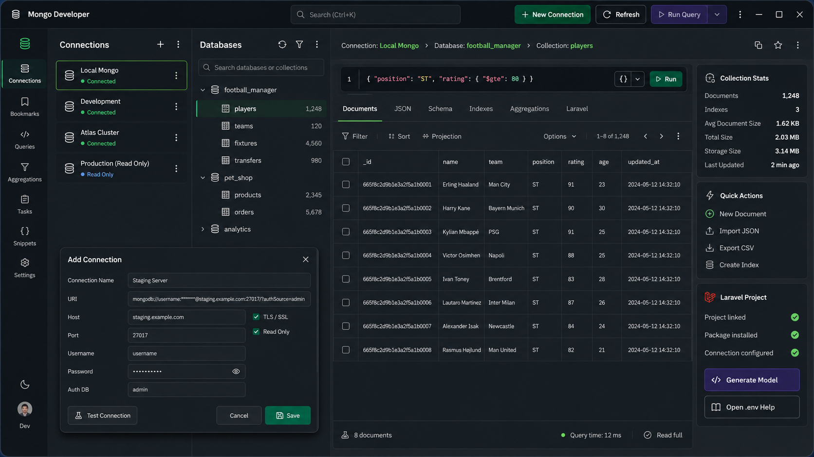

# Mongo Developer

Mongo Developer is a Windows-first MongoDB desktop client built with Go, Wails and Vue, with first-class Laravel tooling.

> Current source release: **V1.5.0 manual-test candidate**. Build the Windows installer with `BUILD-INSTALLER.cmd`, complete `V1.5.0-MANUAL-TEST.md`, and only then publish the installer.



## V1.5.0 highlights

- **Explain Query / Index Advice** for Find JSON, Aggregation, SQL and Eloquent modes.
- Displays winning plan stage, index name, documents examined, keys examined, returned rows/documents and execution time when supplied by MongoDB.
- Suggests a candidate compound index from common filter/sort fields when a collection scan is detected; the user reviews it before creating anything.
- **Saved Queries** with name, mode, database, collection, sort and timestamp, stored locally on the computer.
- Query history increased to 50 entries and now records database, collection and execution duration.
- **Diagnostics** window with app/platform/connection/MongoDB/Laravel/config/backup information plus Copy Diagnostics. Stored passwords are never included.
- Connection health indicator with ping latency, MongoDB server version and explicit Reconnect.
- Unsaved-work protection before switching connections or collections.
- Better query errors with query mode/namespace context, Copy Error, and line/column detail for JSON parse errors when available.
- Expanded keyboard workflow: Ctrl+Enter run, Ctrl+K global filter, Ctrl+L focus query editor, Ctrl+Shift+F format, Ctrl+S save document/query, Esc close the active drawer/tool.
- Read-only profiles now also block aggregation write stages `$out` and `$merge` in both frontend validation and backend enforcement.
- Retains V1.4 Backup & Restore, Laravel/Eloquent integration, compact draggable sidebars and the V1.3.2 query-mode Run-state fix.

See `V1.5.0-RELEASE-POLISH.md` and `V1.5.0-MANUAL-TEST.md`.

## Backup & Restore

- Back up all user databases or one selected database.
- Timestamped ZIP retained in Mongo Developer's local backup store.
- Save As / Download Copy to keep an additional ZIP wherever you choose.
- Restore a stored backup or an external ZIP.
- Delete stored backup ZIPs without touching MongoDB data.
- BSON documents, collection options, views and index definitions are preserved.
- `admin`, `config` and `local` system databases are excluded/protected.
- Restore is blocked on read-only connection profiles.

## Query Workbench

Four query modes are available:

- **Find JSON** — native MongoDB JSON/EJSON filters.
- **Aggregation** — native MongoDB aggregation pipelines.
- **SQL** — convenience translation for SELECT, WHERE, ORDER BY, LIMIT and straightforward JOIN/LEFT JOIN queries.
- **Eloquent** — safe Laravel-style read-query preview translated into MongoDB operations; arbitrary PHP is not executed.

Clicking a collection opens SQL with `SELECT * FROM <collection> LIMIT 50` and runs it automatically. The SQL editor remains a compact normal text editor and grows with the query.

## Laravel bridge

- Link/unlink a Laravel project.
- Discover models under `app/Models` and map them to MongoDB collections.
- Inspect MongoDB Laravel package/configuration.
- Preview common Eloquent read chains.
- Generate a MongoDB Laravel Eloquent model without silently overwriting an existing model.

## Windows build requirements

- Go 1.25+
- Node.js 22+
- Wails v2.14.0
- NSIS
- WebView2

## Build and test

Extract this package to exactly:

```text
E:\projects\Mongo-Developer-v1.5.0
```

Then run:

```powershell
cd E:\projects\Mongo-Developer-v1.5.0
Set-ExecutionPolicy -Scope Process -ExecutionPolicy Bypass
Get-Process MongoDeveloper -ErrorAction SilentlyContinue | Stop-Process -Force
Remove-Item -Recurse -Force .\build\bin -ErrorAction SilentlyContinue
Remove-Item -Recurse -Force .\dist -ErrorAction SilentlyContinue
Remove-Item -Recurse -Force .\frontend\dist -ErrorAction SilentlyContinue
.\BUILD-INSTALLER.cmd
```

The script runs the release gate first and only creates the installer if it passes.

Expected installer:

```text
E:\projects\Mongo-Developer-v1.5.0\dist\MongoDeveloper-Setup-1.5.0.exe
```

After installation complete `V1.5.0-MANUAL-TEST.md` before publication.
